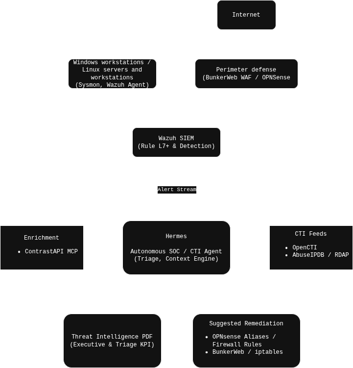

# Autonomous SOC Telemetry & Threat Intelligence Triage Pipeline

[](LICENSE)
[](https://wazuh.com/)
[](https://www.opencti.io/)
[]()

An end-to-end detection, correlation, and automated incident triage pipeline that ingests enterprise telemetry, correlates events with cyber threat intelligence (CTI), and produces executive-ready threat reports with actionable remediation playbooks twice daily.


**All the data used is real data from my home network Wazuh SIEM and not fake sample data.**

---

## Architecture Overview




## Key Engineering Highlights

* **Automated Threat Intelligence Enrichment:** Queries OpenCTI, AbuseIPDB, and RDAP to automatically score inbound adversary infrastructure and classify scanning patterns (e.g., PHP webshell reconnaissance clusters, Tor nodes, bulletproof VPS).
* **Context-Aware Alert Deduplication:** Distinguishes between genuine attacks and benign administrative activity (e.g., suppressing `PSScriptPolicyTest` artifacts from PowerShell 5.1 and OneDrive process hooks into Explorer) to prevent alert fatigue.
* **Telemetry Diagnostics & Gap Detection:** Actively tracks sensor health, identifying dropped telemetry buffers (e.g., Sysmon driver queue overflows during software install storms) to highlight blind spots.
* **Push-Button Containment Artifacts:** Translates triaged intelligence directly into deployable network blocks: OPNsense firewall aliases, BunkerWeb WAF deny lists, and raw iptables rules.


## Real-World Case Study Walkthrough

*(Extracted from the automated triage execution window `2026-10-03T12:00` to `2026-10-04T00:00`)*

### 1. Alert Reduction & KPI Summary
Across a 12-hour evaluation window, the engine ingested **631 events** with rule severity $\ge 7$:
* **Perimeter:** 28 inbound blocks triggered across edge firewalls and BunkerWeb WAF.
* **Rule 92213 False Positive Resolution:** 18 Critical L15 alerts (`Executable file dropped in folder commonly used by malware`) were automatically forensically correlated to PowerShell script-policy self-test executions (`PSScriptPolicyTest_*.ps1`) and safely de-escalated.
* **Signal-to-Noise Ratio:** Raw alerts were compressed into **3 primary adversary profiles** requiring containment.

### 2. Adversary Campaign Correlation
The agent identified and grouped rotating scans from multiple distinct cloud/hosting IPs targeting public web services:
* **Attack Signature:** Systematic PHP backdoor and webshell enumeration (`/class.php`, `/dev.php?p=`, `/wmore1.php`).
* **Source Attribution:** Rotating instances across Microsoft Azure (`AS8075`) and Contabo (`AS51167`).
* **Autonomous Action:** Grouped into aggregated subnets (`207.180.192.0/24`) and fed into WAF deny lists.

### 3. Sensor Bottleneck Identification
During the run, the pipeline flagged an endpoint detection gap on workstation `WCN-WIN11PRO-PC`:
* **Issue:** Sysmon driver queue dropped up to **12,496 events** (`RegistryEvents` and `FileCreate`) due to a queue overflow during a software deployment storm.
* **Finding:** Reported as an operational logging gap rather than an intrusion, outputting immediate configuration tuning recommendations to expand buffer sizes.

### 4. OpenCTI Hash Match Follow-Up
* **Triage Finding:** Rule 100210 matched an internal file SHA256 indicator (`8dd1ebb0...21fc3`, max score 50).
* **Human-in-the-Loop Escalation:** While the hash returned clean against external feeds (suspected stale feed IOC), the pipeline flagged the exact timestamp (`15:22 CEST`) and target workstation for immediate manual analyst pivoting.


## Sample Deliverable

The agent compiles every triage cycle into a structured, executive-ready threat intelligence report:

| Section | Detail Provided |
|---|---|
| **Executive KPI Dashboard** | Alert severity breakdown, MITRE ATT&CK tactic distribution, and perimeter containment metrics |
| **High-Severity Alert Matrix** | Correlated L7–L15 alerts with automated triage verdicts |
| **Threat Actor Dossiers** | Reverse DNS, ASN ownership, abuse scores, and targeting intent |
| **Remediation Plan** | Copy-paste firewall rules (OPNsense alias syntax, iptables drops, WAF commands) |

> 📄 **View the full sample report:** [`docs/sanitized_threat_report_1.pdf`](docs/sanitized_threat_report_1.pdf)


This sample PDF had an early defective design that was modified. Find an more recent sample here:

*(Data is from a different time)*


> 📄 **Better sample report:** [`docs/sanitized_siem_report_2.pdf`](docs/sanitized_siem_report_2.pdf)


Internal host names and IP addresses were removed.


## Containment Output Example

The pipeline generates immediate containment configurations ready for production deployment:

```bash
# OPNsense Custom Alias Addition
# Table: SOC_HOSTILE_AUTOBLOCK
104.208.73.227/32    # Azure Web-shell Scanner
20.204.16.113/32     # Azure Web-shell Scanner
20.28.180.172/32     # Azure Web-shell Scanner
207.180.192.0/24     # Contabo Multi-Host UDP Sweep Cluster

# BunkerWeb WAF Instant Deny
bunkerweb_set_value MULTIWAF_IP_DENY "104.208.73.227 20.204.16.113 20.28.180.172"
bunkerweb reload

